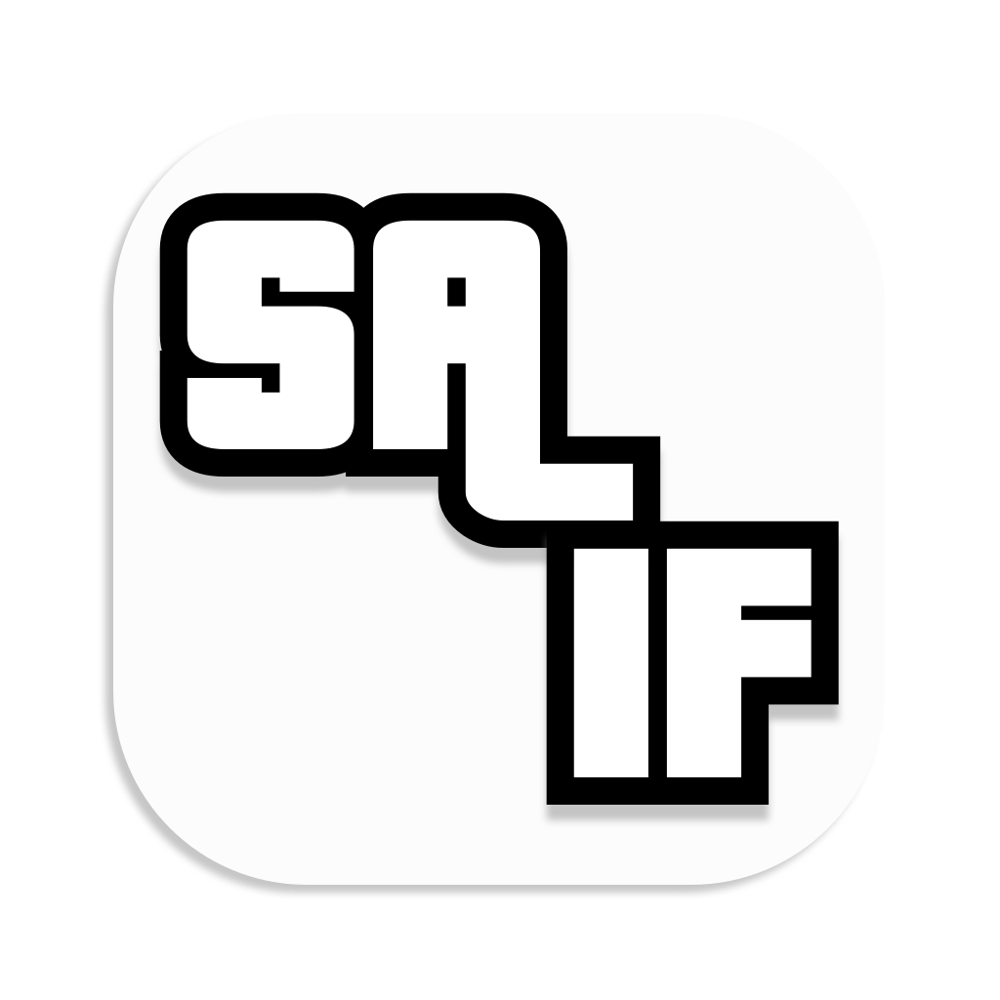

## Saif: native macOS runtime for GTA:SA

Saif is a purpose-built runtime that plays your own copy of GTA: San Andreas on Apple Silicon. No Wine, no CrossOver, no virtual machine, no paid software.

- ✅ Tuned for GTA:SA, so the CPU and GPU paths are optimised directly
- ✅ Free: no subscriptions, no Windows licence, no VM to configure
- ✅ Lightweight app with a simple launcher: pick your game folder, press Launch
- ✅ Widescreen, ultrawide and borderless fullscreen supported

This repository hosts the releases and issue tracker for Saif.

For more information and setup, visit https://saif-runtime.github.io/.

> ⚠️ Note: GTA:SA game files are not included.
> Saif is an independent project and is not affiliated with or endorsed by Rockstar Games or Take-Two Interactive.
> Grand Theft Auto and San Andreas are trademarks of their respective owners. You must own a legitimate copy of the game.